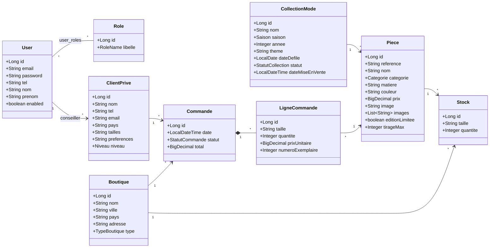

# Diagramme de classes - Aura Hub

Coller le bloc ci-dessous sur https://mermaid.live pour l'exporter en PNG/SVG (livrable demandé).

`Stock` porte l'association Many-to-Many **Piece <-> Boutique** (quantité par taille et par boutique).
Énumérations : RoleName (ADMIN, CONSEILLER), Saison, StatutCollection, Categorie, TypeBoutique, Niveau, StatutCommande.
